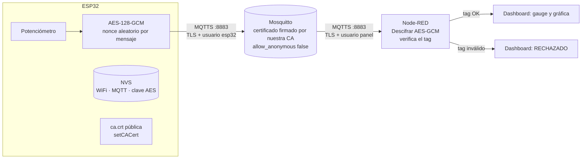
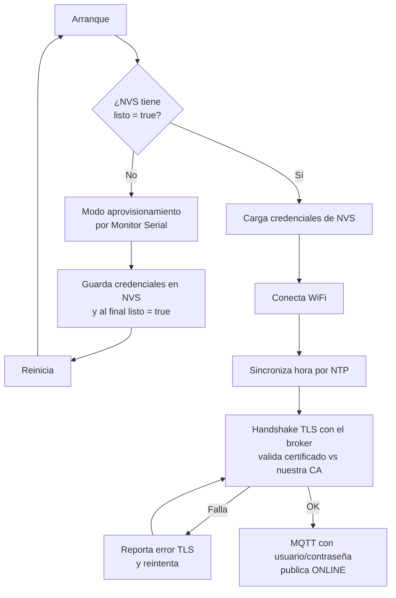
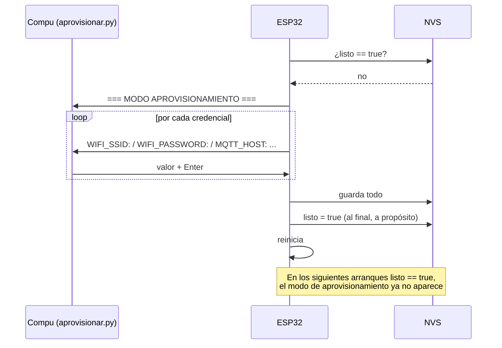

# Práctica 4 - Arquitectura de seguridad

## Vista general: canal cifrado + payload cifrado

## Qué protege cada capa

| Capa | Dónde | Protege contra |
|---|---|---|
| TLS (MQTTS) | Cada tramo: ESP32↔broker y broker↔Node-RED | Que alguien en la red lea o modifique el tráfico; que alguien se haga pasar por el broker |
| Usuario/contraseña en Mosquitto | Al conectarse al broker | Que cualquiera se conecte al broker |
| AES-128-GCM | De extremo a extremo: ESP32 → Node-RED (solo `pot/value`) | Que el broker (o quien lo controle) lea el valor; que alguien altere el valor sin que se note |
| NVS + aprovisionamiento | Dentro del ESP32 | Que las credenciales queden en el código fuente, en el repo o en el binario |

Lo que ve cada quien de un mensaje de `pot/value`:

| Quién | Qué ve |
|---|---|
| Alguien escuchando la red | Basura cifrada por TLS |
| El broker | `tZZsxPLLcxFr78fIXllvYE9aQHbsyATVf616rjKdhQ==` (Base64 cifrado con AES) |
| Node-RED (tiene la clave) | `42.5` |

## Flujo de arranque del ESP32

## Flujo de aprovisionamiento

